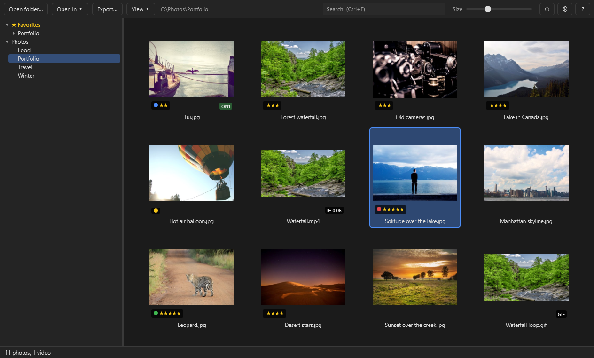
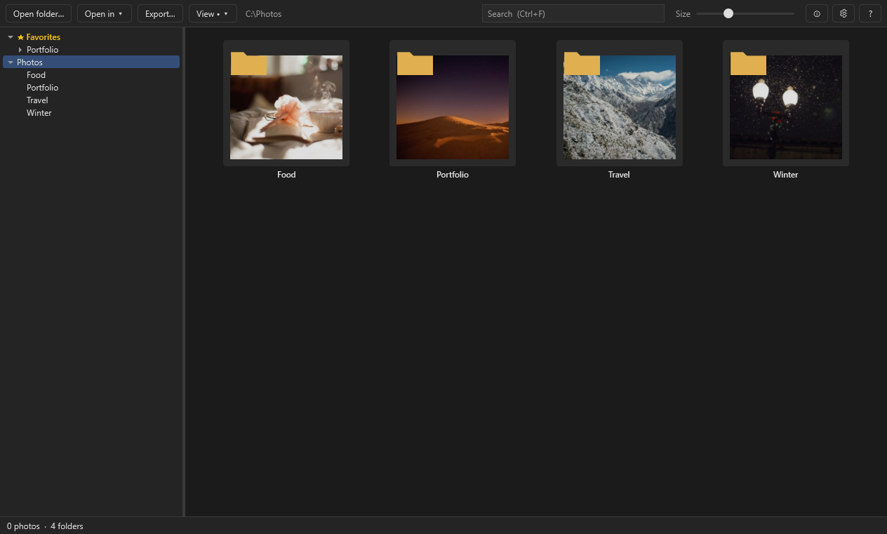
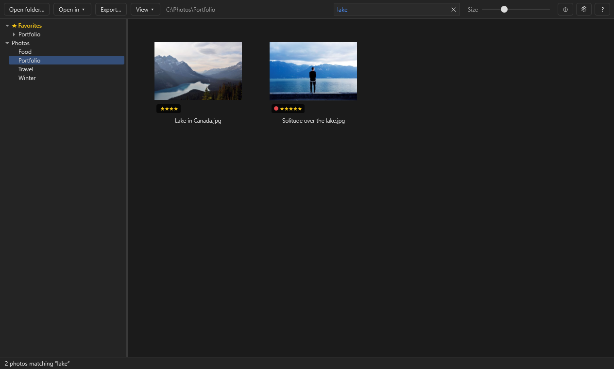
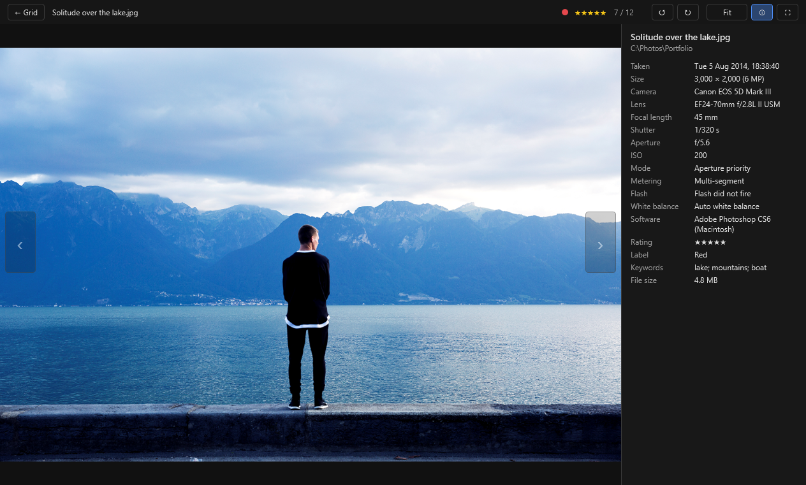
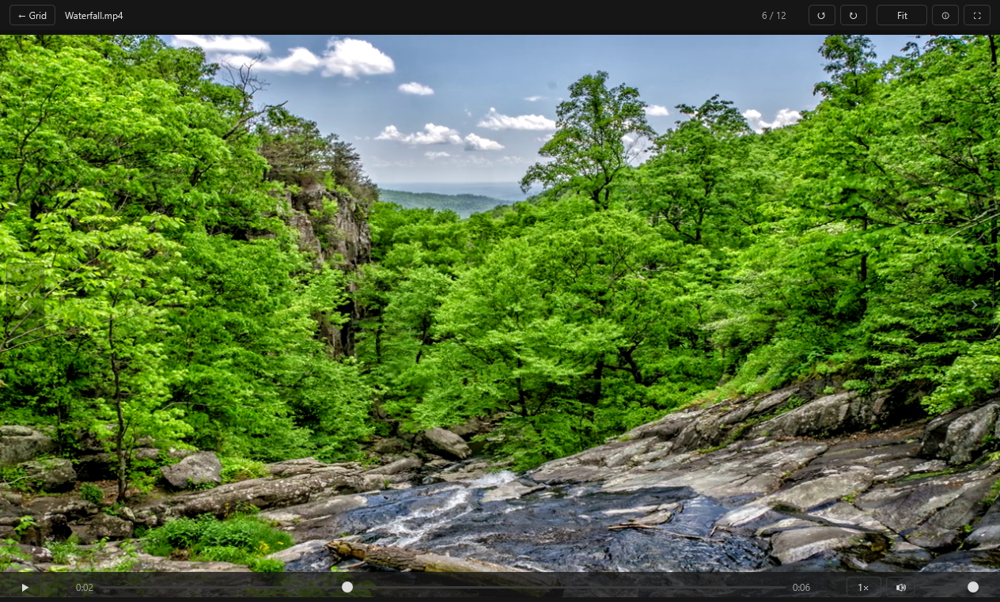
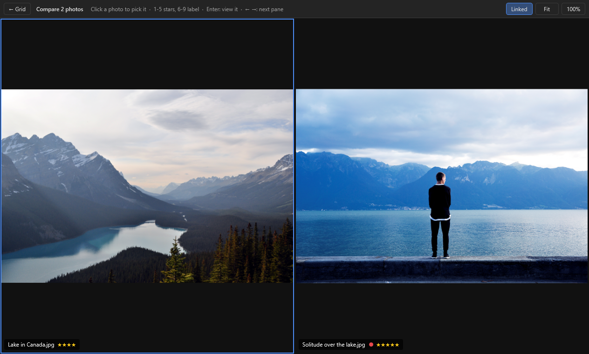

# How to use SnapShack

- [The window](#the-window)
- [Browsing folders](#browsing-folders)
- [The viewer](#the-viewer)
- [RAW files](#raw-files)
- [Opening photos in your editor](#opening-photos-in-your-editor)
- [Deleting, moving, copying and renaming](#deleting-moving-copying-and-renaming)
- [Keyboard shortcuts](#keyboard-shortcuts)
- [Updates](#updates)
- [When something doesn't look right](#when-something-doesnt-look-right)

## The window

- **Folder tree** on the left: your favorites, your Windows Pictures folder (marked "(Windows)") and every drive. Click a folder to show its photos. A folder on a drive that's slow to answer, such as a sleeping USB disk, shows *Loading…* for a moment instead of freezing the window. Don't want the Pictures folder there? Right-click it → **Hide Pictures folder**, or switch off **View ▾ → Show Pictures folder**.
- **Toolbar** at the top:
  - **Open folder…** (Ctrl+O) picks any folder.
  - **Open in ▾** sends the selected photos to an editor.
  - **Export…** saves copies (see [Exporting copies](#exporting-copies)).
  - **View ▾** holds how the grid is laid out:
    - **Sort by name** or **by date taken**, **Ascending** or **Descending**.
    - **Include subfolders** shows the photos in every folder below this one too, as one list.
    - **Folder tiles** shows this folder's subfolders as tiles before the photos.
    - **Show Pictures folder** shows your Windows Pictures folder at the top of the folder tree.
    - **Types** chooses which kinds of files to show (see [Showing only some types](#showing-only-some-types)).
    - **Rating** and **Label** show only some photos, say ★★★ or more, or only Red (see [Ratings and labels](#ratings-and-labels)).
    - **Map** (**M**) shows the photos on a map (see [Map](#map)).
    - **Slideshow** (**S**) shows them full screen, one after another (see [Slideshow](#slideshow)).
    - **Always on top** keeps SnapShack in front of other windows.

    A dot on the button (**View •**) means one of the switches is on, and it turns blue while the Types filter hides photos. Hover over it to see which.
  - **Search** (Ctrl+F) finds photos by name, folder, camera, lens, keyword or year (see [Searching](#searching)). It gets narrower with the window.
  - **Size** sets how big the thumbnails are. **Ctrl + mouse wheel** over the grid does the same. In a narrow window the slider is hidden, and Ctrl + wheel still works.
  - **ⓘ** (or **I**) shows the selected photo's details beside the grid: date, camera, lens, exposure and more. With several photos selected it shows how many and their total size.
  - **⚙ Settings**: editors, color, the update check and file types.
  - **?** has the guide, updates, the log and the version.
- **Status bar** at the bottom: how many photos there are, and while thumbnails are being made, how far along that is.

SnapShack remembers the window size and position, the folder, thumbnail size, sort and everything in View ▾ for next time. It also remembers where you were: in each folder, the photo you were on is selected again when you come back to it, even days later; if you closed SnapShack in the viewer, it opens in the viewer on that photo; and the mouse Back and Forward buttons still know the folders you visited.

## Browsing folders

The first time you open a folder, SnapShack makes a thumbnail of every photo in it. The ones on screen come first. After that the folder opens instantly, and only photos that are new or have changed get a new thumbnail.

Your mouse's **back** and **forward** buttons (or **Alt+←** and **Alt+→**) go back to the folders you were in before and forward again, like in Explorer. In the viewer they flip to the previous and next photo instead.

Badges on a thumbnail tell you what it is:

- **RAW**, **PSD**, **HEIC**, **GIF**, **ICO**: the file type.
- **ON1**: the photo has an ON1 edit file (`.on1`) next to it, so you've edited it in ON1 Photo RAW.

Some tiles say why there's no picture:

- **Can't read this file**: the file is damaged, or isn't the type its name says. SnapShack skips it and carries on.
- **No preview: saved without "Maximize Compatibility"**: a Photoshop file saved without its flattened preview. Open it in Photoshop and save it again with **Maximize PSD and PSB File Compatibility** turned on.

The grid keeps up with the folder: when you (or your editor) add, change, rename or delete photos, the grid shows it within a second. **F5** refreshes it by hand, which is handy on network drives.

### Favorites

Folders you open often can sit at the top of the folder tree, under **★ Favorites**: right-click a folder → **Add to Favorites**, or press **Ctrl+D** for the folder that's open. Right-click a favorite to remove it or move it up or down. A favorite whose folder is gone (renamed, or on a drive that isn't plugged in) shows as "not found" until it's back.

### Include subfolders

With **Include subfolders** on, the grid shows the photos in the folder and in every folder below it. Sorting by name keeps each folder's photos together. Sorting by date mixes them all in the order they were taken, which is a good way to see a whole year at once.

### Folder tiles

With **Folder tiles** on, subfolders appear as tiles at the start of the grid, each with a photo from inside it. Double-click a folder tile (or press Enter) to open it, and press **Backspace** (or Alt+↑) to go back up.

### Showing only some types

**View ▾ → Types** has a tick for each kind of file: RAW, JPEG, PNG, TIFF, HEIC, PSD / PSB, GIF, Icons and Videos. Untick the ones you don't want to see. **Hide JPEGs that have a RAW** keeps the RAW and hides the JPEG when your camera saved both (IMG_0001.NEF next to IMG_0001.JPG). **Show all types** turns the filter off.

While a filter is on, the **View** button turns blue, the menu says **Types (filtered)** and the status bar says how many photos it's hiding. SnapShack remembers it for next time.

## Ratings and labels

Give photos stars and color labels as you look through them, in the grid or the viewer:

- **1** to **5** set that many stars, **0** takes them off.
- **6**, **7**, **8**, **9** set a **Red**, **Yellow**, **Green** or **Blue** label, the same keys as Lightroom. Press it again to take it off. **Purple** is in the right-click menu.
- With several photos selected, the key sets them all. Right-click → **Rating** / **Label** does the same.

Stars and the label color show at the bottom left of each thumbnail, at the top of the viewer and in the info panel. **View ▾ → Rating** and **Label** show only some photos, for example ★★★★ or more to pick the best. These filters aren't remembered, like the search.

**Where they're saved:** in an `.xmp` file next to the photo (IMG_0001.xmp), the standard "sidecar" that ON1, Lightroom and Bridge use. SnapShack never changes the photo file itself. Only the rating and label are changed in an existing `.xmp`: ON1 or Lightroom edits stored in it are kept. When a camera saved a RAW and a JPEG with the same name, IMG_0001.xmp belongs to the RAW, as in Lightroom, and the JPEG gets IMG_0001.JPG.xmp, so each keeps its own rating. Sidecars move, copy and rename along with their photo.

SnapShack also shows ratings already in your photos: from `.xmp` files, from inside the photo (Lightroom, Bridge), and Windows' own stars (Properties → Details). Lightroom reads SnapShack's ratings for RAW files; for JPEGs, Lightroom only reads what's inside the file.

## Searching

Type in the **Search** box (or press **Ctrl+F**) and the grid shows only the photos that match. It searches the open folder, or the folder and everything below it when **Include subfolders** is on. To search your whole archive, open its top folder and turn on Include subfolders.

Each word is looked for in the file name, the folder names below the open folder, the camera, the lens and the photo's keywords (from Lightroom, ON1, Photoshop or Windows, including .xmp sidecar files). Every word has to match, and capitals don't matter.

| Type | Finds |
|---|---|
| `d850` | photos taken with a Nikon D850 |
| `birthday mom` | photos with both words anywhere: name, folder or keywords |
| `"pool party"` | the exact phrase |
| `-raf` | leaves out photos that match, here Fuji RAW files |
| `1998` | photos taken in 1998, or with 1998 in their name or folder |
| `1995-1999` | a range of years, the same way |
| `2019-06` | June 2019 (also finds folders named 2019_06 or 201906) |

A year also finds photos by their folder or file name, because scans and older files often have no date inside, but their folder does.

The first time you search a big folder, SnapShack reads the camera and keyword details of photos it hasn't seen yet. The status bar shows how far along it is, and matches appear as they're found. After that it's instant. **Esc** clears the search; **Enter** or **↓** moves into the results. The search isn't kept when you close SnapShack.

## The viewer

Double-click a photo, or select it and press **Enter**.

- **Flip:** ← and → (also Space and Backspace, Page Up and Page Down, Home and End, the ‹ › buttons, or your mouse's back and forward buttons). The photos either side are already loaded, so flipping is instant.
- **Animated GIFs** play by themselves and loop. **Space** (or **K**) pauses and plays one; ← → still flip.
- **Zoom:** the mouse wheel zooms in and out around the pointer. Drag to look around.
- **100%:** **Z**, a double-click or the zoom button switches between fitting the window and 100% (one photo pixel per screen pixel). **Ctrl+0** fits it again. (The plain number keys rate photos.)
- **Fullscreen:** **F**. The top bar and the arrows hide; move the mouse to the top or the sides to get them back.
- **Info:** **I** or the **ⓘ** button opens a panel beside the photo: when it was taken, its size, the camera and lens, shutter speed, aperture, ISO and the rest, plus GPS position, artist and copyright when the camera saved them. It stays open as you flip until you close it. It's the same switch as the grid's ⓘ: on in one is on in both.
- **Back to the grid:** **Esc** or **← Grid**. The photo you were looking at is selected.

When you zoom in past the picture the viewer loaded, it loads the full resolution in the background. "Loading full resolution…" shows in the top bar, and the picture sharpens in place when it's ready.

## Videos

Videos sit in the grid with your photos: MP4, MOV, AVI, MTS/M2TS (camcorders), MPG, 3GP, WMV, M4V and MKV, from old camera clips to phone HEVC. Each tile shows a frame from early in the clip and its length (**▶ 0:34**). They sort by the date they were filmed when the file says so (phones, Nikon, iPhone and many cameras do), and **View ▾ → Types → Videos** hides them or shows only them.

Open a video like a photo. It shows a still frame with a big **▶**; nothing plays until you ask.

- **Play / pause:** **Space** (or **K**), a click on the video, the **▶** button or the play button in the bar at the bottom. At the end, **↻** plays it again.
- **The bar:** the time, a slider to jump or scrub, the length, the speed, mute and volume. While a video plays it fades after a couple of seconds; move the mouse to bring it back.
- **Jump:** **Shift+←** / **Shift+→** go 5 seconds back or ahead. **,** and **.** step one frame back or ahead (and pause).
- **Speed:** hold the mouse button down on a playing video for 2×, until you let go. **Ctrl + mouse wheel** (or **Shift+<** / **Shift+>**) steps from 0.25× up to 4×, and a click on the speed button goes back to 1×. Each clip starts at normal speed; the sound keeps its pitch.
- **Sound:** **M** mutes, **↑** / **↓** change the volume. Volume and mute are remembered.
- **Zoom** works as for photos: the wheel zooms, drag pans, **Z** or a double-click for 100%, even while the video plays.
- **← / →** still go to the previous or next photo or video. Leaving a video stops it.
- **Info (I)** shows its length, codec and frame rate as well as the date.

**Copying:** in the viewer, **Ctrl+C** (or right-click → **Copy frame**) copies the frame you're looking at, paused or playing, as a picture at the video's own size (up to your screen's size), like a screenshot without the framing. Right-click → **Copy video file** copies the clip itself. In the grid, **Ctrl+C** copies the video file, to paste into Explorer or attach to an email.

Rotating (**Ctrl+R** / **Ctrl+L**), ratings, rename, move, delete, drag and drop and **Open in…** work for videos as for photos. Videos aren't exported or compared, and the slideshow and screen saver show only photos. Colors in a video aren't matched to your monitor's profile.

## Comparing photos

To pick the best of a burst or a few similar shots, select 2, 3 or 4 photos in the grid (Ctrl+click) and press **C**, or right-click → **Compare**. They appear side by side (four as 2 × 2).

- **Zoom and move them together:** the mouse wheel, dragging and double-click work as in the viewer, and with **Linked** on (the default, **L** switches it) every photo follows to the same spot at the same zoom. **Z** or **100%** shows them all at 100%, **Fit** (Ctrl+0) fits them again.
- **Click a photo** to pick it (it gets a blue frame), or move with **← →**. Rating keys (1-5, 6-9), right-click and Ctrl+C act on the picked photo, so you can star the keeper as you go. **Enter** opens it in the viewer.
- **Esc** goes back to the grid with the photos still selected.

Like the viewer, each photo shows the fast preview first and loads full resolution when you zoom past it.

## Slideshow

Press **S** (or **View ▾ → Slideshow**) to show the photos in the grid full screen, one after another with a soft fade, starting from the selected photo (or the one in the viewer). It shows what the grid shows: a search, a filter (say ★★★★ or more) or **Include subfolders** decides which photos are in it.

- **Space** pauses and plays, **← →** (or a click) step back and forward, **↑ ↓** make each photo stay longer or shorter.
- **I** shows or hides the name and date at the bottom.
- **1-5** and **6-9** rate and label the photo on screen, so a slideshow is also a quick way to pick favorites.
- **Esc** ends it; the last photo shown is selected in the grid.

How long each photo stays, random order and the name and date are set in **⚙ Settings → Slideshow**.

### As the screen saver

SnapShack can be your Windows screen saver: when the PC sits idle, a slideshow of your photos in random order, on every monitor.

1. In **⚙ Settings → Screen saver**, **Add folder…** the folders to show, for example your whole photo archive; everything in their subfolders is included. With none chosen it shows your Pictures folder.
2. Click **Add to Windows' screen savers…** and say **Yes** when Windows asks for permission. (Or tick the same box in the setup.) This puts a tiny SnapShack.scr in Windows' screen saver folder; it's only needed once, also across updates.
3. Windows' own **Screen Saver** dialog opens: pick **SnapShack**, set the wait, and click **OK**. Later, **Windows' screen saver settings…** in SnapShack's Settings opens it again.

**Preview** in SnapShack's Settings starts it straight away. Any key or mouse movement ends it, and it starts at once even with a huge archive: the folders are read while the first photos show. Uninstalling SnapShack removes it from Windows' list too.

## Map

Press **M** (or **View ▾ → Map**) to see the photos in the grid on a map: every photo that recorded where it was taken (most phones do, and cameras with GPS). Nearby photos are grouped into a numbered circle; zoom in with the mouse wheel or **+ / −** and they split up.

- **Click a dot or a circle** to see those photos in the viewer. **Esc** goes back to the map, and **Esc** again to the grid.
- The map shows what the grid shows: with **Include subfolders** on, a whole tree of folders; with a search or a filter on, just those photos.
- The bar at the top says how many of the photos have a location. Photos without one (most older cameras, film scans) aren't on the map.

The map needs an internet connection: the map pictures come from **OpenStreetMap** (© OpenStreetMap contributors). Like any web map, OpenStreetMap's servers see which parts of the map are being looked at. Your photos, their names and their exact positions stay on your PC.

## RAW files

RAW files contain a JPEG preview the camera made when you took the photo. SnapShack shows that, so browsing RAWs is as fast as browsing JPGs.

- **Most Nikon cameras** store a full-size preview, so even 100% is instant.
- **Fujifilm cameras** store a smaller preview. Zooming in past it decodes the RAW itself, which takes a few seconds (X-Trans files are slow to decode).
- **Very old cameras**, like the Nikon D1 series, store only a tiny preview, so SnapShack decodes the RAW. Their thumbnails take a moment the first time.

A RAW decoded on its own looks darker and flatter than the camera's preview, because it has none of the camera's picture style. That's very noticeable if you underexpose to protect the highlights. SnapShack copies the preview's brightness and colour onto the decoded RAW, so the picture only gets sharper when the full resolution arrives. Highlights the camera clipped stay clipped, as in the preview; use your RAW editor to pull them back.

## Opening photos in your editor

Select one or more photos, then:

- right-click and choose **Open in ON1 Photo RAW** (or another editor), or
- use **Open in ▾** on the toolbar, or
- press **Ctrl+E** for the first editor in your list.

In the viewer, right-click the photo or press Ctrl+E. The same menu has **Show in Explorer**, **Copy file path** and **Copy image** (Ctrl+C, also in the grid). Copy image puts the photo on the clipboard as a picture (sRGB, at most 4000 pixels on the long edge; Fujifilm RAWs come from their 1920-pixel preview), ready to paste into email, chat, Word or KlipShot, where you can mark it up. With several photos selected, Ctrl+C copies the files instead, to paste into a folder in Explorer or attach to an email.

The first time it starts, SnapShack looks for ON1 Photo RAW (the newest year you have), PhotoCraft, Photoshop and Lightroom Classic, and adds the ones it finds. **Editors…** at the bottom of the menu (or **⚙ Settings → Editors → Change…**) changes the list:

- **Add editor** adds any program.
- **Browse…** picks a program's `.exe`.
- **↑** moves an editor up. The first one opens with Ctrl+E.
- **✕** removes it.
- **Find installed editors** looks again, for example after you install Photoshop.

Lightroom Classic imports a photo it's given into its catalogue, rather than just opening it.

When an editor saves its result as a new file next to the original (ON1 does), the new file appears in the grid straight away.

## Deleting, moving, copying and renaming

Select photos in the grid (or look at one in the viewer), right-click, and choose:

- **Rename…** (**F2**): one photo at a time. The extension stays the same.
- **Move to** and **Copy to**: pick **Choose folder…**, or one of the last few folders you used.
- **Delete** (**Del**): moves the photos to the Recycle Bin, after asking. If the drive has no Recycle Bin (some network drives), Windows warns you that the files will be deleted for good.

### Drag and drop

Drag photos from the grid onto a folder in the tree on the left, or onto a folder tile. It works like Explorer:

- To a folder on the **same drive** the photos **move**; to **another drive** they're **copied**.
- Hold **Ctrl** to copy instead, or **Shift** to move. The status bar says which will happen before you let go.
- Or drag with the **right** mouse button: when you let go, SnapShack asks **Move here**, **Copy here** or **Cancel**. The one in bold is what a normal drag would do; Enter picks it.
- Hold the photos over a closed folder in the tree for a moment and it opens, so you can go deeper. Drag near the top or bottom of the tree to scroll it.
- To drag several photos, select them first, then drag any one of them.

You can also drag photos **out** of SnapShack, into an Explorer window, onto the desktop or into an editor, and drag files **in** from Explorer: onto a tree folder, a folder tile, or the grid itself (the folder that's open).

These use Windows' own file copying, so you get Explorer's progress window for big copies and its "replace or skip" question when a file is already there. Explorer's **Undo** (Ctrl+Z in an Explorer window) works on them too.

**Edit files go with their photo.** ON1's `.on1` file and an `.xmp` file with the same name are moved, copied, renamed and deleted along with the photo. When two photos share a name (IMG_0001.NEF and IMG_0001.JPG) and you only move one, the edit files stay with the one left behind.

## Rotating

**Ctrl+R** turns the selected photos (or the one in the viewer) a quarter turn clockwise, **Ctrl+L** the other way. The right-click menu has **Rotate right** and **Rotate left**, and the viewer has ↺ ↻ buttons.

- **JPEG and TIFF**: SnapShack changes the photo's orientation tag, the same small note a camera writes when you shoot upright. The picture itself isn't re-saved, so there's no loss of quality, and ON1, Photoshop and other programs see the rotation too.
- **RAW, PSD, PNG and HEIC**: these files aren't changed. SnapShack remembers the rotation and uses it in the grid, the viewer and exports, but other programs won't see it.

## Exporting copies

**Export…** in the toolbar (or right-click, or **Ctrl+Shift+E**) saves copies of the selected photos, for email, the web, a print lab or another program. The originals aren't touched.

- **Format**: JPEG (with a quality setting; 90 shows no visible loss), TIFF (8 or 16-bit, LZW or no compression), PNG, WebP, AVIF or JPEG XL.
- **Size**: the original size, or a number of pixels on the long edge, short edge, width or height, a box the photo fits inside, or a percentage. **Don't enlarge smaller photos** leaves small photos at their own size.
- **Sharpen**: a little sharpening after making photos smaller, so they stay crisp. **Light** suits the screen.
- **Resolution**: the ppi written in the file. It doesn't change the pixels; it only tells print and layout programs how big to print.
- **Color**: **Convert to sRGB** is right almost everywhere. **Keep the photo's profile** keeps Adobe RGB or another wide profile, for printing or further editing.
- **Metadata**: keep the camera details, date, copyright and keywords, or leave them all out. **Remove location** takes out GPS positions.
- **Save in**: the first time this is an **Exported** folder next to the photos. Files that are already there aren't replaced unless you tick **Replace files that are already there**: the new file gets a number instead, like `IMG_0001 (2).jpg`. **Add to name** puts text after each name, like `_web`.

RAW files export as you see them in the viewer: the camera's full-size preview, or a full RAW decode matched to it, so they're 8-bit. Export runs in the background; the status bar shows progress, with **Stop**, and **Show** to open the folder afterwards. SnapShack remembers your choices for next time.

## Color

SnapShack shows photos in your monitor's color profile, the one set in Windows' **Color Management** (or by a calibration tool), and honors the profile inside each photo (Adobe RGB, Display P3 from iPhones, ProPhoto). On an ordinary sRGB screen you'll see little difference; on a calibrated or wide-gamut monitor colors match ON1 and Photoshop. If the window moves to another monitor, SnapShack switches to that monitor's profile. To compare, turn it off and on with **Match colors to the monitor** in **⚙ Settings**.

## Keyboard shortcuts

| In the grid | |
|---|---|
| Enter or double-click | View the photo, or open the folder tile |
| Ctrl+E | Open in the first editor |
| Ctrl+C | Copy image (a video, or several items: copy the files) |
| C | Compare the 2-4 selected photos |
| M | Map of the photos with a location |
| S | Slideshow from the selected photo |
| 1 – 5 / 0 | Stars / no rating |
| 6 7 8 9 | Red, Yellow, Green, Blue label (again: off) |
| Ctrl+R / Ctrl+L | Rotate right / left |
| Ctrl+Shift+E | Export… |
| I | Photo info beside the grid |
| F2 | Rename |
| Del | Delete (to the Recycle Bin) |
| Ctrl+O | Open folder… |
| Ctrl+F | Search (Esc clears it) |
| Ctrl + mouse wheel | Thumbnail size |
| Backspace or Alt+↑ | Go up a folder |
| Ctrl+D | Add the open folder to Favorites (again: remove it) |
| Mouse back / forward, or Alt+← / Alt+→ | Back to the folder you were in before / forward again |
| F5 | Refresh the folder |
| Ctrl+A | Select all |

| In the viewer | |
|---|---|
| → ← (Space, Backspace, Page Up/Down) | Next / previous photo |
| Home / End | First / last photo |
| Mouse wheel | Zoom around the pointer |
| Z, Ctrl+1 or double-click | Fit ↔ 100% |
| Ctrl+0 | Fit |
| 1 – 5 / 0 | Stars / no rating |
| 6 7 8 9 | Red, Yellow, Green, Blue label (again: off) |
| F or F11 | Fullscreen |
| I | Photo info |
| Ctrl+R / Ctrl+L | Rotate right / left |
| Ctrl+Shift+E | Export… |
| Ctrl+E | Open in the first editor |
| Ctrl+C | Copy image (a video: the frame on screen) |
| F2 / Del | Rename / delete |
| Esc | Back to the grid |

| On a video in the viewer | |
|---|---|
| Space or K, or a click | Play / pause |
| Shift+← / Shift+→ | 5 seconds back / ahead |
| , / . | One frame back / ahead |
| Hold the mouse button | 2× while held |
| Ctrl + mouse wheel, Shift+< / Shift+> | Slower / faster (0.25× – 4×) |
| M | Mute |
| ↑ / ↓ | Volume |

## Opening photos from Explorer

The setup lists SnapShack under **Open with** for every photo and video type it reads, and adds **Browse with SnapShack** to the right-click menu of folders and drives. It doesn't change which app opens your photos when you double-click them: Windows leaves that choice to you.

- **To use SnapShack for a type:** in Explorer, right-click a photo of that type, choose **Open with → Choose another app**, pick SnapShack and click **Always**. Do it once per type, say for JPEG and TIFF, while NEFs keep opening in ON1. Windows only lets you make that choice yourself: an app can't set it, and Windows only shows **Always** when you open the picker from Explorer. **⚙ Settings → File types** lists which app opens each type now.
- Opening a photo shows it in the viewer, in its folder, so the arrow keys go through the rest of the folder.
- If SnapShack is already open, the photo opens in that window instead of a new one, even when you open several photos at once.
- The portable copy doesn't change Windows until you tick **List SnapShack in Explorer's "Open with"** in **⚙ Settings**. Untick it before deleting the folder. The setup's uninstaller removes it by itself.

## Updates

**? → Check for updates** asks GitHub whether there's a newer SnapShack. If there is, SnapShack asks before downloading anything, checks the download, and restarts on the new version. Your thumbnails and settings are kept. SnapShack also checks quietly once a day when it starts, and tells you in the status bar when there's an update. To stop that, untick **Look for a new version once a day** in **⚙ Settings**.

## When something doesn't look right

- **A thumbnail looks wrong or old:** press F5. If it's still wrong, delete `%LocalAppData%\SnapShack\thumbs.db` and SnapShack rebuilds every thumbnail as you browse.
- **An error:** details are in `%LocalAppData%\SnapShack\snapshack.log`.
- **Start over:** quit SnapShack and delete the `%LocalAppData%\SnapShack` folder. Your photos are never touched.

---

The photos in this guide's screenshots are CC0 photos from Wikimedia Commons: see [the photo credits](docs/CREDITS.md).
