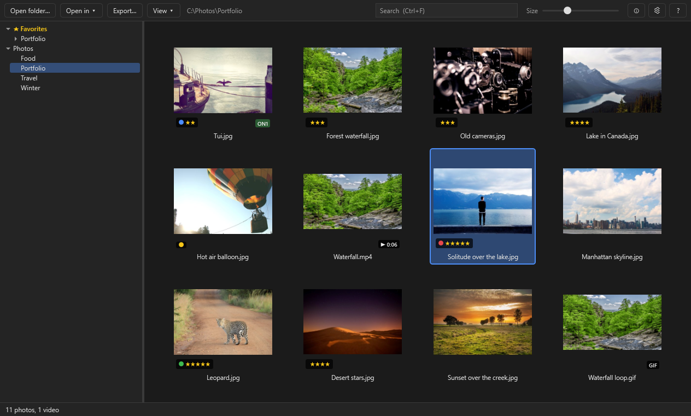

# SnapShack

A fast photo browser for Windows. Point it at a folder and flip through years of photos — JPG, PNG, TIFF, HEIC, Nikon and Fujifilm RAW, DNG and Photoshop files, and your videos too — without waiting, then send the one you want to your editor.

> [!IMPORTANT]
> **Microsoft Defender or SmartScreen may now and then warn about SnapShack.** That's a false alarm: SnapShack has no malicious code. SnapShack is code-signed (the publisher shows as Bruce David Maloney), but a new signature has to build up trust with Microsoft first, and until it has, Defender's machine-learning check (detection names ending in `!ml`) can still distrust a new download. See [Install](#install) and the guide's [Updates](GUIDE.md#updates) section for how to let it run. If you'd like a second opinion first, upload the download to [VirusTotal](https://www.virustotal.com).

- **Fast thumbnails.** RAW files show the camera's own preview instead of being decoded, so a folder of NEFs fills in in seconds. Thumbnails are kept, so the next visit is instant, and only new or changed files are redone.
- **Big folders.** The grid only draws what's on screen, so 50,000 photos scroll as smoothly as 50.
- **Viewer.** Double-click a photo for a full-window view: arrow keys to flip (the next and previous photos are already loaded), wheel to zoom, drag to pan, Z for 100%, F for fullscreen. Zooming in loads full resolution in place, and RAW files keep the look your camera gave them, even when you underexpose to protect highlights.
- **Videos.** Clips from old cameras to today's phones sit with your photos, with their length, and play in the viewer: scrub, step frames, speed up (hold the mouse for 2×) and copy the frame you're on as a picture.
- **Sort and find.** By name or by the date the photo was taken, either way round. Include subfolders to see a whole tree at once, or show subfolders as tiles and click through them.
- **Print.** Lay photos out on the page your way: drag them on, resize, snap them into line, or use cells (1 to 9 per page, or your own grid) with slots to drop photos into. Exact print sizes like 5×7, a sharpness badge on every photo, and RAW files printed from full resolution.
- **Open in your editor.** Send photos to ON1 Photo RAW, PhotoCraft, Photoshop or any program you set up, with a right-click or Ctrl+E. Photos you've edited in ON1 get an ON1 badge, and when your editor saves a new file next to the original, it appears straight away.
- **Your files stay as they are.** SnapShack only reads your photos. It never moves, renames or changes them.
- A setup, or a portable `SnapShack.exe`. Neither needs admin rights or a .NET install.

## Install

Each release on [Releases](https://github.com/Argusi/SnapShack-releases/releases) comes two ways. Both are the same SnapShack; pick one.

- **Setup:** download `SnapShack-<version>-win-x64-setup.exe` and run it. It installs SnapShack just for you into `%LocalAppData%\Programs\SnapShack` and adds it to the Start menu.
- **Portable:** download `SnapShack-<version>-win-x64.zip`, unzip it into any folder and run `SnapShack.exe`.

SnapShack is code-signed, but while its signature is new, the first time you run it Windows SmartScreen may still say "Windows protected your PC". Click **More info**, then **Run anyway**. If Defender removes it instead, see the guide's [Updates](GUIDE.md#updates) section.

## Using SnapShack

1. Pick a folder in the tree on the left, or click **Open folder…**.
2. Double-click a photo to view it. **←** and **→** flip, **Esc** goes back.
3. Right-click a photo and choose **Open in…** to edit it.

The [guide](GUIDE.md) covers everything, and **? → How to use SnapShack** (F1) opens it; **? → What's new** opens the [changelog](CHANGELOG.md).

## Supported files

| | |
|---|---|
| Photos | JPG, PNG, TIFF, HEIC/HEIF, GIF (animated GIFs play), ICO icons |
| RAW | Nikon NEF/NRW, Fujifilm RAF (X-Trans too), DNG (including phone RAW) |
| Photoshop | PSD, PSB (needs "Maximize Compatibility", see the guide) |
| Video | MP4, MOV, AVI, MTS/M2TS, MPG, 3GP, WMV, M4V, MKV (H.264, HEVC, MPEG-4, Motion JPEG, MPEG-2 and more) |

## Where SnapShack keeps things

Thumbnails, settings and a log are in `%LocalAppData%\SnapShack`. Deleting that folder resets SnapShack; thumbnails are rebuilt as you browse.

## Credits

The photos in the screenshots are CC0 photos from Wikimedia Commons: see [the photo credits](docs/CREDITS.md).

## Licence

Free to use. See [LICENSE](LICENSE). SnapShack includes third-party software under its own licences: see [THIRD-PARTY-NOTICES.txt](THIRD-PARTY-NOTICES.txt).
